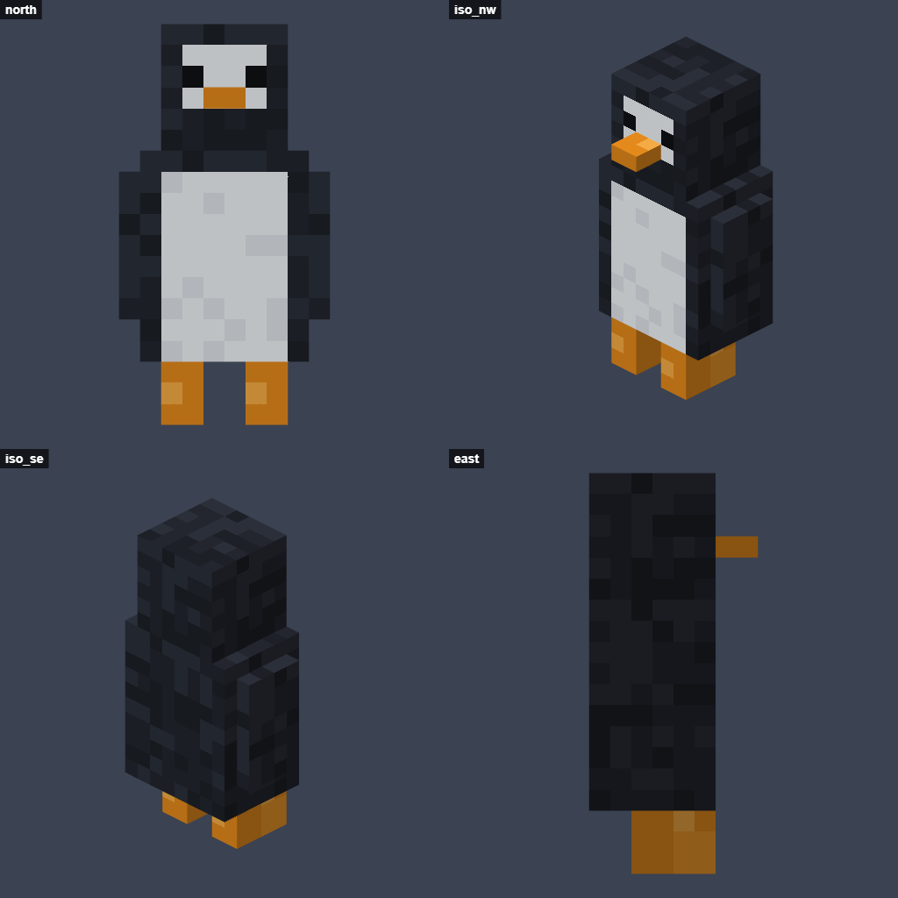
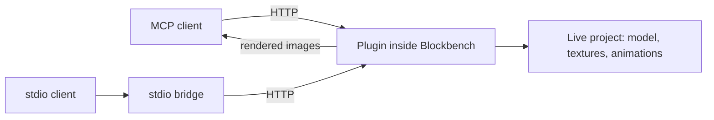

<div align="center">

# Blockbench MCP

**Let AI assistants build, paint and animate Minecraft models in Blockbench, and see what they are doing.**

[](https://github.com/sikorafranciszek/blockbench-mcp-addon/actions/workflows/ci.yml)
[](LICENSE)
[](https://www.blockbench.net/)
[](https://modelcontextprotocol.io/)

[Polska wersja](README.pl.md)



*This is the image the AI receives. It built, textured and animated this penguin using only the plugin's tools.*

</div>

## Why

A Blockbench plugin runs inside the app, so an AI client connected to it works on your open project, live on your screen. Three things make it practical for real modeling:

- **The AI can see.** `capture_preview` renders any angle or animation frame without moving your camera, so the AI can check its work and fix mistakes.
- **It works at a high level.** One call creates a whole tree of bones and cubes, and `paint_faces` paints a face in its own pixels with no UV math.
- **You stay in control.** Every tool call is one `Ctrl+Z` step, and files are never overwritten unless the call explicitly asks for it.

The plugin is a single JavaScript file with no dependencies.

## Quick start

**1. Install [Blockbench](https://www.blockbench.net/) 5.2 or newer.** On Windows:

```bash
winget install JannisX11.Blockbench
```

**2. Load the plugin.** In Blockbench, open `File > Plugins...`, choose `Load Plugin from File`, select [`plugin/blockbench_mcp.js`](plugin/blockbench_mcp.js) and confirm. It loads automatically from then on, as long as the file stays in place.

Blockbench asks for network access because the plugin runs a local server. Choose **Always allow for this plugin**.

**3. Connect your AI client.** Keep Blockbench open while the client connects.

Claude Code:

```bash
claude mcp add --transport http blockbench http://127.0.0.1:3939/mcp
```

Any client that supports Streamable HTTP uses the same URL: `http://127.0.0.1:3939/mcp`.

Clients that only support stdio, such as a local Claude Desktop configuration, use the included bridge, which needs Node.js 18 or newer:

```json
{
  "mcpServers": {
    "blockbench": {
      "command": "node",
      "args": ["/absolute/path/to/blockbench-mcp-addon/bridge/stdio-bridge.mjs"]
    }
  }
}
```

**4. Ask for something.**

> Make a penguin in Bedrock format with a Minecraft-style texture and a walk animation. Check the preview after each stage.

The server address and a log of recent AI activity are in `Tools > MCP Server`.

## Tools

| Area | Tools |
| --- | --- |
| **Preview** | `capture_preview`, `get_texture`, `capture_window` |
| **Modeling** | `add_elements`, `update_elements`, `delete_elements`, `duplicate_elements`, `get_outliner` |
| **Texturing** | `generate_texture_template`, `paint_faces`, `paint_texture`, `create_texture`, `import_texture`, `apply_texture`, `save_texture` |
| **Animation** | `create_animation`, `add_keyframes`, `list_animations`, `delete_animation` |
| **Projects** | `get_state`, `list_formats`, `new_project`, `update_project`, `open_file`, `switch_project`, `close_project`, `save_project`, `export_model`, `validate_model`, `undo`, `redo`, `dismiss_dialog` |
| **Scripting** (off by default) | `run_script` |

Highlights:

- `capture_preview` frames the model automatically and combines several views into one labeled sheet. It also supports perspective and orthographic cameras, wireframe and UV modes, and poses from any animation frame.
- `add_elements` accepts cubes, nested groups and locators, plus meshes from raw geometry or primitives (sphere, cylinder, cone, torus, plane).
- `duplicate_elements` can mirror a limb and swap `left`/`right` in its name.
- Paint operations include fill, rectangle, line, ellipse, gradient, noise, image and exact pixel grids.
- `add_keyframes` takes numbers or Molang expressions.

## Supported formats

All formats in your Blockbench install work, including:

- **Java** block and item models
- **Bedrock** entities and blocks, with animations
- **Vanilla models to repaint:** player skins and Minecraft mobs and objects such as the creeper or chest
- **2D art:** pixel-art icons and block or item textures
- **Generic models,** exported to glTF, OBJ, FBX, Collada or STL

## Security

- The server listens only on `127.0.0.1` and rejects requests that have an `Origin` header or an unexpected `Host`, so websites open in your browser cannot control Blockbench.
- There is no password. Any program running on your computer can connect.
- Connected clients can read and write files at the paths they pass, but an existing file is only overwritten when the call sets `overwrite: true`.
- `run_script` runs arbitrary JavaScript with access to your files, so it is off by default. Turn it on with the `MCP: Allow run_script` setting only if you trust the connected client.

See [SECURITY.md](SECURITY.md) to report a vulnerability.

## Troubleshooting

| Problem | What to do |
| --- | --- |
| The client cannot connect | Make sure Blockbench is open, then run `curl http://127.0.0.1:3939/health`. A browser may get a 403 here, because the server rejects websites. |
| The port is taken | Change `MCP: Server port` in the Blockbench settings and update the URL in your client. The stdio bridge takes the port as its last argument. |
| A tool does not finish | A dialog may be waiting in Blockbench. Tool results report open dialogs, and `dismiss_dialog` closes them. |
| `capture_window` shows an old image | The Blockbench window is covered, so it is not repainting. `capture_preview` is always current. |

## How it works



Plugins run in the Blockbench window process with full access to its API (`Cube`, `Group`, `Texture`, `Canvas`, `Undo`). Blockbench does not give plugins the `http` module, so the plugin implements a small HTTP/1.1 server for MCP Streamable HTTP on top of `net`.

## Development

There is no build step: edit [`plugin/blockbench_mcp.js`](plugin/blockbench_mcp.js) and reload the plugin from `File > Plugins...`.

Check syntax:

```bash
npm run check
```

Run the end-to-end tests against a running Blockbench with the plugin loaded. They open and close their own project tabs and write files only to `test/output`:

```bash
npm test
```

Build the example model:

```bash
npm run demo
```

See [CONTRIBUTING.md](CONTRIBUTING.md) for details.

## License

[MIT](LICENSE)

This is an independent project and is not affiliated with Blockbench or Mojang. Minecraft is a trademark of Mojang.
