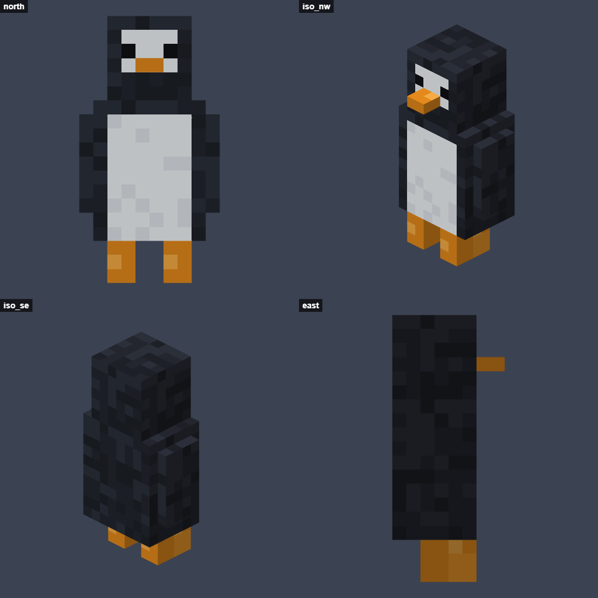
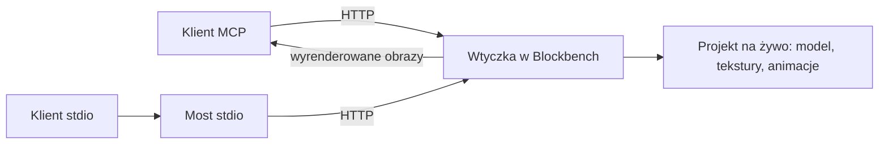

<div align="center">

# Blockbench MCP

**Asystent AI buduje, maluje i animuje modele do Minecrafta w Blockbench i widzi, co robi.**

[](https://github.com/sikorafranciszek/blockbench-mcp-addon/actions/workflows/ci.yml)
[](LICENSE)
[](https://www.blockbench.net/)
[](https://modelcontextprotocol.io/)

[English version](README.md)



*Tak wygląda obraz, który dostaje AI. Tego pingwina zbudowały, pomalowały i zanimowały same narzędzia wtyczki.*

</div>

## Dlaczego

Wtyczka działa wewnątrz Blockbench, więc podłączony klient AI pracuje na Twoim otwartym projekcie, na żywo na ekranie. Trzy rzeczy sprawiają, że nadaje się to do prawdziwego modelowania:

- **AI widzi efekty.** `capture_preview` renderuje dowolną stronę lub klatkę animacji bez przesuwania Twojej kamery, więc AI może sprawdzać swoją pracę i poprawiać błędy.
- **AI pracuje wysokopoziomowo.** Jedno wywołanie tworzy całe drzewo kości i kostek, a `paint_faces` maluje ścianę w jej własnych pikselach, bez liczenia UV.
- **Ty masz kontrolę.** Każde wywołanie to jeden krok `Ctrl+Z`, a pliki są nadpisywane tylko wtedy, gdy wywołanie wyraźnie o to prosi.

Wtyczka to jeden plik JavaScript bez zależności.

## Szybki start

**1. Zainstaluj [Blockbench](https://www.blockbench.net/) 5.2 lub nowszy.** W systemie Windows:

```bash
winget install JannisX11.Blockbench
```

**2. Wgraj wtyczkę.** W Blockbench otwórz `Plik > Wtyczki...`, wybierz `Załaduj plugin z pliku`, wskaż [`plugin/blockbench_mcp.js`](plugin/blockbench_mcp.js) i potwierdź. Od tej pory wtyczka ładuje się sama, o ile plik zostaje w tym samym miejscu.

Blockbench zapyta o dostęp do sieci, bo wtyczka uruchamia serwer lokalny. Wybierz **Always allow for this plugin**.

**3. Podłącz klienta AI.** Blockbench musi być włączony, gdy klient się łączy.

Claude Code:

```bash
claude mcp add --transport http blockbench http://127.0.0.1:3939/mcp
```

Każdy klient obsługujący Streamable HTTP używa tego samego adresu: `http://127.0.0.1:3939/mcp`.

Klienci obsługujący tylko stdio, na przykład lokalna konfiguracja Claude Desktop, używają dołączonego mostu, który wymaga Node.js 18 lub nowszego:

```json
{
  "mcpServers": {
    "blockbench": {
      "command": "node",
      "args": ["/pelna/sciezka/do/blockbench-mcp-addon/bridge/stdio-bridge.mjs"]
    }
  }
}
```

ChatGPT działa w chmurze, więc potrzebuje tunelu. Zobacz [instrukcję dla ChatGPT i ngrok](docs/chatgpt-ngrok.pl.md).

**4. Poproś o coś.**

> Zrób pingwina w formacie Bedrock, z teksturą w stylu Minecrafta i animacją chodu. Sprawdzaj podgląd po każdym etapie.

Adres serwera i historię działań AI znajdziesz w `Tools > MCP Server`.

## Narzędzia

| Obszar | Narzędzia |
| --- | --- |
| **Podgląd** | `capture_preview`, `get_texture`, `capture_window` |
| **Modele** | `add_elements`, `update_elements`, `delete_elements`, `duplicate_elements`, `get_outliner` |
| **Tekstury** | `generate_texture_template`, `paint_faces`, `paint_texture`, `create_texture`, `import_texture`, `apply_texture`, `save_texture` |
| **Animacje** | `create_animation`, `add_keyframes`, `list_animations`, `delete_animation` |
| **Projekty** | `get_state`, `list_formats`, `new_project`, `update_project`, `open_file`, `switch_project`, `close_project`, `save_project`, `export_model`, `validate_model`, `undo`, `redo`, `dismiss_dialog` |
| **Skrypty** (domyślnie wyłączone) | `run_script` |

Najważniejsze możliwości:

- `capture_preview` sam kadruje model i łączy kilka widoków w jeden opisany arkusz. Obsługuje też kamerę perspektywiczną i ortograficzną, tryby siatki i UV oraz pozy z dowolnej klatki animacji.
- `add_elements` przyjmuje kostki, zagnieżdżone grupy i lokatory oraz siatki z surowej geometrii lub brył (kula, walec, stożek, torus, płaszczyzna).
- `duplicate_elements` potrafi zrobić lustrzane odbicie kończyny i zamienić `left`/`right` w nazwie.
- Operacje malowania to m.in. wypełnienie, prostokąt, linia, elipsa, gradient, szum, obraz i dokładne siatki pikseli.
- `add_keyframes` przyjmuje liczby lub wyrażenia Molang.

## Obsługiwane formaty

Działają wszystkie formaty dostępne w Twoim Blockbench, m.in.:

- **Java:** modele bloków i przedmiotów
- **Bedrock:** moby i bloki, także z animacjami
- **Gotowe modele do przemalowania:** skórki graczy oraz moby i obiekty z Minecrafta, takie jak creeper czy skrzynia
- **Grafiki 2D:** ikony w stylu pixel art oraz tekstury bloków i przedmiotów
- **Modele ogólne:** z eksportem do glTF, OBJ, FBX, Collada i STL

## Bezpieczeństwo

- Serwer nasłuchuje tylko na `127.0.0.1` i odrzuca żądania z nagłówkiem `Origin` lub nieoczekiwanym `Host`, więc strony otwarte w przeglądarce nie mogą sterować Blockbench. Jedynym wyjątkiem jest żądanie z tajnym kluczem z `Tools > MCP Server`.
- Serwer nie ma hasła. Może się z nim połączyć każdy program uruchomiony na Twoim komputerze.
- Podłączony klient może czytać i zapisywać pliki pod podanymi ścieżkami, ale istniejący plik nadpisze tylko z `overwrite: true`.
- `run_script` uruchamia dowolny JavaScript z dostępem do Twoich plików, dlatego jest domyślnie wyłączony. Włączaj ustawienie `MCP: Allow run_script` tylko wtedy, gdy ufasz podłączonemu klientowi.
- Tunel, np. ngrok, udostępnia serwer w internecie, a chroni go ten klucz. Każdy, kto ma pełny adres, dostaje opisany wyżej dostęp, więc przed użyciem tunelu przeczytaj [instrukcję dla ChatGPT](docs/chatgpt-ngrok.pl.md).

Lukę w zabezpieczeniach zgłoś zgodnie z [SECURITY.md](SECURITY.md).

## Rozwiązywanie problemów

| Problem | Co zrobić |
| --- | --- |
| Klient nie może się połączyć | Sprawdź, czy Blockbench jest włączony, i uruchom `curl http://127.0.0.1:3939/health`. Przeglądarka może tu dostać błąd 403, bo serwer odrzuca strony internetowe. |
| Port jest zajęty | Zmień `MCP: Server port` w ustawieniach Blockbench i adres w kliencie. Most stdio przyjmuje port jako ostatni argument. |
| Narzędzie nie kończy pracy | W Blockbench może czekać otwarte okno. Wyniki narzędzi informują o tym, a `dismiss_dialog` je zamyka. |
| `capture_window` pokazuje stary obraz | Okno Blockbench jest zasłonięte, więc się nie odświeża. `capture_preview` zawsze pokazuje stan aktualny. |

## Jak to działa



Wtyczki działają w procesie okna Blockbench, z pełnym dostępem do jego API (`Cube`, `Group`, `Texture`, `Canvas`, `Undo`). Blockbench nie udostępnia wtyczkom modułu `http`, więc wtyczka ma własny mały serwer HTTP/1.1 dla MCP Streamable HTTP, zbudowany na module `net`.

## Rozwój

Nie ma etapu budowania: edytuj [`plugin/blockbench_mcp.js`](plugin/blockbench_mcp.js) i przeładuj wtyczkę w `Plik > Wtyczki...`.

Sprawdzenie składni:

```bash
npm run check
```

Testy end-to-end wymagają uruchomionego Blockbench z wtyczką. Otwierają i zamykają własne karty projektów, a pliki zapisują tylko w `test/output`:

```bash
npm test
```

Budowa przykładowego modelu:

```bash
npm run demo
```

Szczegóły znajdziesz w [CONTRIBUTING.md](CONTRIBUTING.md).

## Licencja

[MIT](LICENSE)

To niezależny projekt, niepowiązany z Blockbench ani Mojang. Minecraft jest znakiem towarowym firmy Mojang.
